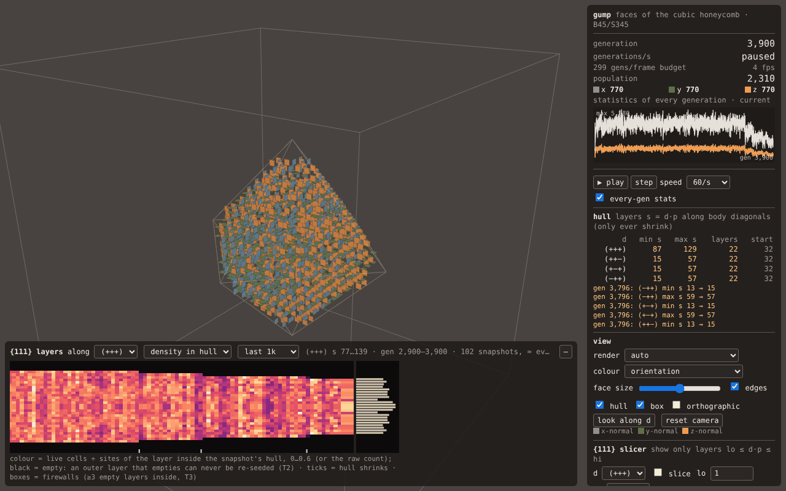

# gump — web

The gump automaton (faces of the cubic honeycomb, B45/S345; see `docs/AUTOMATON.md`)
computed on the GPU with WebGL2 and drawn with three.js. Static files, one runtime
dependency (`three@0.186.1`), no bundler.

*Side-11 closed cube, generations 2,900–3,900. Bottom left: the `{111}` layer kymograph along
(+++). The outer layers go black for good at 3,290, 3,477 and 3,796 (cyan ticks = the exact
generations of the hull shrinks, from the per-generation statistics). That is the staircase
collapse of `research/NOTEBOOK.md`, peeling one layer per face.*

## Run

    cd web && npm install          # three only
    npm run serve                  # http://127.0.0.1:8173/web/
    npm run build                  # dist/ = deployable static site (copies the three files it uses)

Everything a run depends on is in the URL, so any run can be shared (**copy link** adds the
current generation, which the app fast-forwards to on load):

| parameter | meaning |
|---|---|
| `seed=cube&n=11` | closed cube of side n (all faces of an n³ block of cubes) |
| `seed=key&k=5` | the original's number-key seeds 1–9 |
| `seed=legacy&H=60` | the original's default seed for habitat size H (`bc=torus` + even H = its exact array torus) |
| `seed=soup&shape=cube\|oct\|slab&n=12&density=0.3&rng=1[&layers=3]` | random soup in a cube of side n, an L1-ball of radius n cubes, or m `{111}` layers |
| `seed=cells&cells=x,y,z;…` or `seed=cells&cz=…` | explicit cells, doubled coordinates; `cz` = deflate-raw + base64url of a one-byte-per-cube bitmap (what the editor writes for > 40 cells) |
| `box=auto\|N\|NXxNYxNZ`, `abs=1` | `auto` = smallest box holding the seed's diagonal hull forever (T2) plus 2 cubes; `abs=1` = cells are absolute array coordinates in that box (edited states) |
| `bc=dead\|torus` | outside of the box is dead, or the box wraps |
| `gen=G`, `g0=G0`, `play=1`, `speed=max\|1…1000` | fast-forward to G (at `speed`); `g0` = generation number of the seed (edited mid-run) |
| `view=auto\|raymarch\|quads\|instanced`, `color=orientation\|layer\|change`, `face=0.6`, `cam=x,y,z[,zoom]`, `ortho=1` | |
| `diag=0..3`, `slice=lo,hi`, `kwin=1000`, `rec=0` | the chosen diagonal (kymograph, slicer, layer colours, look-along), the `{111}` slice, the kymograph window, sampled instead of every-generation statistics |

Keys: space play/pause, `.`/→ step, `E` edit, `[` `]` move the slice, 1–9 legacy key seeds.
Drag to orbit, wheel to zoom.

## What is on screen

- **Readout**: generation, generations/s, the per-frame budget, fps, population (total and per
  orientation), and a population strip. By default the statistics are computed **for every
  generation**: after each step, a GPU reduction writes into a 4096-slot ring texture, and each
  frame reads back the slots it filled. The strip and the hull-shrink log therefore miss nothing,
  and shrink events carry exact generations. Untick *every-gen stats* to sample every ~40 ms
  instead, which is faster for small boxes. The line under the population says which mode is on
  and which generation the shown numbers belong to.
- **Hull table**: min/max `s = d·p` for the four body diagonals, width in layers, and width at
  the start. A side that has ever moved is highlighted and logged with its generation, because
  that is an irreversible event (T2).
- **`{111}` layers** (bottom left): a kymograph along the chosen diagonal, with time across, layer
  `s` up the side, and colour by layer.
  - Colour is either the **density** (live cells ÷ sites of that layer inside the snapshot's own
    hull, on a fixed 0–0.6 scale) or the raw count.
  - Black means empty. Since an outer layer that empties can never be re-seeded, peeling shows as
    bands that go black for good.
  - Cyan ticks mark hull shrinks; cyan boxes are **firewalls** (≥ 3 consecutive empty layers
    strictly inside the hull, permanent by T3), each logged once when first seen.
  - The right-hand bars show the latest snapshot's profile. Hovering reads out generation,
    layer, live / sites; clicking slices the 3D view to that layer.
  - The data come from whole-state snapshots, read back asynchronously and analysed in a Web
    Worker. Each column is tagged with its generation, and the label states the actual snapshot
    spacing. Columns are sample-and-hold, and the time window can be all, 1k, 10k, 100k or 1M
    generations.
- **View**:
  - Renderers: auto, the ray-march (DDA), vertex-pulled quads, or instanced quads.
  - **Colour modes**: *orientation* (the original's palette); *layer ABC* (`(s−1)/2 mod 3`
    along the chosen diagonal, which shows the kagome stacking); *born / survived / died* (the
    previous generation is the other ping-pong texture; died cells are drawn small).
  - Options: face size, orthographic camera, *look along d*.
- **`{111}` slicer**: show only layers `lo ≤ d·p ≤ hi`. It can step a layer at a time, jump to
  the outermost live layer on either side (*face +* / *face −*), or show the whole hull. Both the
  ray-march (as a ray clip plus a per-cell test) and the quads honour it.
- **Editor** (`E`, or *✎ edit*): for constructing a seed, or editing a paused run in place.
  - **The edit set** is either an axis plane (as in the original's construction mode: normal
    x/y/z, stepped with ↑↓) or a `{111}` layer, which is a kagome net. Its empty slots are drawn
    as faint outlines; the rest of the state stays visible, translucent.
  - **Clicking** toggles the slot under the cursor. The pick is a CPU replica of the
    ray-marcher's DDA.
  - **Symmetric painting**: the toggle is applied to the cell's whole orbit under none,
    inversion, the x/y/z mirrors, C3 / C3v / D3d about the diagonal, or the full O_h. The centre
    is the pattern's centre, snapped to a cube centre or a vertex.
  - **Other tools**: fill, random fill or clear the set; clear all; undo.
  - **Leaving the editor** makes the edited state the run's seed, as an `abs=1` cell list at
    generation `g0`. The link then reproduces the run from the edit onward. The "exact" flag is
    re-evaluated from the edited state's hull.
- **Environment**: the box, an edge alert, and whether the run is provably the infinite-space run.
  **resize**, **fit hull** and **⇄ torus** all preserve state.

## Test

    node test/run.mjs                           # everything, ~3 min on software GL
    node test/run.mjs only=soups,async,ring,layers,app   # skip the golden runs (~1.5 min)

Headless Chromium with SwiftShader WebGL2 (no flags needed). 66 checks:

- **golden**: the GPU stepper reproduces the population of every generation of
  `reference/golden/*.txt` (closed cubes, side 8–11, up to 4,218 generations). It is checked in
  three configurations: packed in an auto-sized dead-outside box, plain, and the original's array
  torus. For 80 generations the full state is also compared with the CPU stepper, and the state
  must be static after the last logged generation.
- **soups**: 30 random soups (torus and dead-outside; lane counts 1–32, partial lanes, thin
  boxes, multi-row atlases). The GPU state and every GPU statistic equal the CPU's at every
  generation.
- **async / ring**: the fenced readback equals a blocking read. The per-generation ring returns
  the right statistics for *every* generation, in order. This covers 1-, 2- and 3-pass
  reductions and 4,201 generations through a 4,096-slot ring, so it wraps around.
- **layers**: per-layer counts from a snapshot (the worker's code) equal those from the dense
  cells, on 4 boxes including the plain layout. The real worker round-trips. Hull-site counts
  and firewall detection are checked too.
- **app**: the real page, driven by URL.
  - Golden populations through seed placement, the loop and the ring.
  - Every view must agree: instanced and pulled quads pixel for pixel; the ray-march with brick
    skipping and without, pixel for pixel; the ray-march and the quads up to anti-aliased
    outlines (checked by eroding the difference mask). This holds across 7 scenes that include
    the slicer, the layer and change colour modes, an orthographic camera, and 4³ and 8³ bricks.
  - **Editor**: a real click toggles one cell and the stats follow. O_h painting produces an
    orbit that is closed under O_h. An edit round-trips through a `cells=` link. A mid-run edit
    through a compressed `cz=` link reloads bit-identically, resumes the generation count, and
    steps on to the same population as the in-place run.

Tools:
- `test/shot.mjs out.png "<query>" <gen>` saves a screenshot.
- `test/peelshot.mjs` makes the peel image above.
- `test/bench*.mjs` are the benchmarks below.
- `node test/bench.mjs keys.html` runs the legacy key seeds to completion.

## Architecture

**State.** One `RGBA32UI` texel holds one 32-bit word per orientation.
- **Packing.** Bits are packed along x in *strided lanes*: lane b of word w is cube `b·WN + w`.
  The x-neighbour of a lane is then the next word, except at the row ends, where it is a 1-bit
  shift. This is exact for any size, torus or dead-outside.
- **Atlas.** z-slices are tiled into a 2D atlas, so one draw call is one generation.
- **Step shader.** A fragment does 19 word fetches and a carry-save adder tree on `uvec3`s, then
  applies `~b3 & ((b2 & ~b1) | (alive & ~b2 & b1 & b0))`.
- **Plain layout.** `lanes=1` gives one cube per texel; it is kept for comparison.

**Loop** (`src/main.js`). Each frame:
1. A fence on last frame's work sets the generations-per-frame budget: +10 % if the GPU kept up,
   −30 % if not.
2. Step. With every-gen stats on, each step is followed by the reduction into ring slot
   `gen mod 4096`.
3. Flush this frame's ring slots into a fresh pixel-pack buffer behind a fence, and collect any
   that have landed.
4. Start a snapshot readback of the whole atlas if none is in flight and the worker is idle. The
   cadence adapts to the worker's time.
5. Rebuild the brick-occupancy texture if needed, then render.

Nothing ever blocks on the GPU. The only blocking reads are user actions: edit, resize,
toggling the boundary.

**Reduction** (`src/gl/stats.js`). One MRT pass over 8×8 texel blocks, then at most 16×16-block
passes, with the final pass writing into the ring. That is 2 passes up to ~128³ and 3 beyond.

**Views** (`src/render.js`). All read the state through `THREE.ExternalTexture`, and share one
GLSL cell predicate that implements the slice, colour modes and editor categories.
- **Quads** pull 6 vertices per cell slot from `gl_VertexID`. The editor uses them plus a
  translucent pass for its ghost slots.
- **Ray-march**: a DDA through the box, where each step crosses exactly one face, i.e. one cell.
  - Rays are clipped to the diagonal hull. This is safe even when the hull is stale, because it
    only shrinks.
  - Rays are also clipped to the slice.
  - In boxes larger than 48 it skips empty 4³/8³ bricks. It restarts just before the brick's exit
    plane, and computes each crossing from the plane equation, so the result is bit-identical to
    an uninterrupted walk.
- `view=auto` picks quads up to 2.7 M cell slots (about 96³ cubes) and the ray-march beyond.

## Measured (SwiftShader, i.e. a CPU pretending to be a GPU, on a 4-core box shared with two CPU-heavy agents)

Absolute numbers mean little for a real GPU; the ratios informed the choices. The app's own
generations/s readout is what a human with a GPU will see.

| cubes | packed gen/s | plain gen/s | packed + every-gen stats | layer analysis (worker) | snapshot |
|---:|---:|---:|---:|---:|---:|
| 16³ | 8,600 | – | 3,400 (2.5× slower: draw-call bound) | 1.3 ms | 16 kB |
| 32–36³ | 1,100–5,600 | 80–250 | 720 (1.5×) | 1.2 ms | 41 kB |
| 128³ | 50–126 | 1.6–4.7 | 38 (1.4×) | 33 ms | 1 MB |
| 256³ | 4–6 | 0.2 | 4.3 (1.4×) | 138 ms | 8.5 MB |

Per-generation statistics cost 1.4–2.5× here. On a real GPU a small box is bound by draw calls,
and recording triples them (step + 2 reduction passes), so expect up to ~3× for small boxes and
much less for big ones. That is why it can be switched off.

Render ms per frame at 1280×800 (`node test/bench-render.mjs`):

| run | box | ray-march | ray-march, no bricks | pulled quads | instanced |
|---|---:|---:|---:|---:|---:|
| cube n=8, gen 0 | 27³ | 309 | 379 | 99 | 1,389 |
| key 8 still life | 27³ | 263 | 224 | 110 | 647 |
| cube n=11, gen 600 | 36³ | 304 | 317 | 235 | 1,579 |
| cube n=20, gen 0 | 63³ | 339 | 593 | 1,044 | 8,170 |
| cube n=10 in a 128³ box | 128³ | 394 | 365 | 8,209 | 70,661 |

- The hull clip is the big win for the ray-march (1,590 → 180 ms when introduced). Brick skipping
  adds 0.85–1.75×, and only pays in bigger boxes, hence the threshold of 48.
- Quads cost ~18 vertices per cell slot regardless of population, so they are out of the
  question at 128³+; the ray-march's cost there stays flat.
- I did not build a stream-compacted live-cells-only quad path. With the ray-march handling big
  boxes, it would only help mid-size boxes with sparse populations, and in WebGL2 it needs a
  histopyramid with a CPU-side draw count that is always a frame stale.

## Known limits

- The kymograph is sampled: columns are whole-state snapshots, at most one per frame, and slower
  for big boxes (8.5 MB readback plus about 140 ms analysis at 256³). Its spacing is printed on
  it. The scalar statistics and hull events are exact per generation, unless switched off.
- Snapshot spacing is set by frame rate and analysis time, not by generations. Fast-forward at a
  moderate `speed` when a fine kymograph of a short window matters (`test/peelshot.mjs` does this).
- Torus: the hull is computed in array coordinates, so it is meaningless once a pattern wraps.
  The ray-march does not clip on a torus, and the "fits" test there is a conservative extent check.
- The odd-H legacy array torus is not reproduced (odd-H legacy seeds run in a dead-outside box,
  which is exact for the golden H=55 run).
- The box is bounded by the atlas (8192² here, about 512³ cubes packed). The editor uses quads,
  so it is slow beyond ~100³.
- `cz=` links compress structured states well (a mid-run edit of a side-5 cube: 621 characters),
  but a large random state is incompressible and gives a long link.
