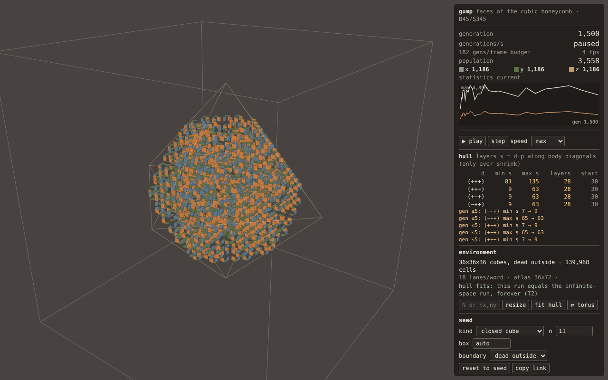

# gump — web

The gump automaton (faces of the cubic honeycomb, B45/S345; see `docs/AUTOMATON.md`)
computed on the GPU with WebGL2 and drawn with three.js. Static files, one runtime
dependency (`three@0.186.1`), no bundler.

## Run

    cd web && npm install          # three only
    npm run serve                  # http://127.0.0.1:8173/web/
    npm run build                  # dist/ = deployable static site (copies the three files it uses)

Everything a run depends on is in the URL, so any run can be shared (the **copy link** button adds
the current generation, which the app fast-forwards to on load):

| parameter | meaning |
|---|---|
| `seed=cube&n=11` | closed cube of side n (all faces of an n³ block of cubes) |
| `seed=key&k=5` | the original's number-key seeds 1–9 |
| `seed=legacy&H=60` | the original's default seed for habitat size H (`bc=torus` + even H = its exact array torus) |
| `seed=soup&shape=cube\|oct\|slab&n=12&density=0.3&rng=1[&layers=3]` | random soup in a cube of side n, an L1-ball of radius n cubes, or m `{111}` layers |
| `seed=cells&cells=1,0,0;-1,0,0;…` | explicit cells, doubled coordinates |
| `box=auto\|N\|NXxNYxNZ` | `auto` = smallest box that holds the seed's diagonal hull forever (T2) plus 2 cubes |
| `bc=dead\|torus` | outside of the box is dead, or the box wraps |
| `gen=G`, `play=1`, `speed=max\|1…1000`, `view=auto\|raymarch\|quads\|instanced`, `face=0.6`, `cam=x,y,z[,zoom]` | |

Keys: space play/pause, `.`/→ single step, 1–9 legacy key seeds. Drag to orbit, wheel to zoom.

## Test

    node test/run.mjs                       # everything, ~2.5 min on software GL
    node test/run.mjs only=soups,async,app  # skip the golden runs (~15 s)

Headless Chromium with SwiftShader WebGL2 (no flags needed). What is checked:

- **golden** — the GPU stepper reproduces the population of every generation of
  `reference/golden/*.txt` (closed cubes side 8–11, up to 4218 generations), via the GPU
  statistics reduction, in three configurations: bit-packed in an auto-sized dead-outside box,
  plain one-texel-per-cube, and (even H) the original's own array torus. For the first 80
  generations the full state is also compared with the CPU stepper, and the state after the last
  logged generation must be static.
- **soups** — 30 random soups (density 0.3 per cell, 12 generations each), torus and dead-outside,
  sizes chosen to hit every seam of the packing and the atlas: lane counts 1, 2, 3, 5, 7, 17, 22,
  23, 32; partially filled last lanes; 1–3 cubes thick; forced multi-row atlases. Every generation
  the full GPU state equals `src/cpu.js` (a stepper written from the doubled-coordinate definition,
  independent of the cube-index neighbour table the shader uses), and every GPU statistic
  (per-orientation counts, bounding box, the 8 hull extents) equals its CPU computation.
- **async** — the PBO + fence readback returns what a blocking readback returns.
- **app** — the real page, driven by URL (`seed=legacy&H=40&gen=23` etc.), lands on the golden
  population through seed placement, the adaptive loop and the asynchronous statistics; and the
  ray-marched, vertex-pulled and instanced views produce the same image (instanced = pulled exactly;
  ray-march vs quads differ only on anti-aliased outlines, checked by eroding the difference mask).

`test/shot.mjs out.png "<query>" <gen>` saves a screenshot (`APP_PATH=/web/dist/` to shoot the built
site); `test/bench*.mjs` are the benchmarks below; `node test/bench.mjs keys.html` runs the nine
legacy key seeds to completion and prints their hull widths.

## Architecture

**State.** One texel holds one 32-bit *word* per orientation (R/G/B = X/Y/Z faces, `RGBA32UI`).
Bit-packing runs along x with *strided lanes*: lane b of word w is cube `i = b·WN + w`, so the
x-neighbour of every lane is simply the next word, except at the two row ends where it is that
word shifted by one bit — exact for any size, torus or not, without 32-alignment. z-slices are
tiled into a 2D atlas, so one draw call advances the whole volume one generation. A fragment
fetches 19 words (the 3×3 rows around it, ±1 word on the 5 axis rows) and counts the 12
neighbours of 3×32 cells at once with a carry-save adder tree on `uvec3`s (~45 bitwise ops per
plane); B45/S345 is then `~b3 & ((b2 & ~b1) | (alive & ~b2 & b1 & b0))`. The same shader with one
lane per word is the plain layout (`lanes=1`), kept for comparison and tests. Shapes are `#define`d,
so changing the box recompiles.

**Loop** (`src/main.js`). Each animation frame: (1) poll the fence inserted after last frame's work;
if the GPU finished, raise the generations-per-frame budget by 10 %, if not, cut it by 30 % and step
only once — the queue never holds more than about a frame, so stepping, rendering and input stay
responsive and the budget converges to "fill the frame"; (2) step up to the budget (or the chosen
rate); (3) statistics: if no readback is in flight and 40 ms have passed, run the reduction on the
current state and `readPixels` into a fresh pixel-pack buffer behind a fence; a later frame collects
it (`getBufferSubData` only after the fence signals, ~0.2 ms); (4) render. Statistics are thus
samples tagged with their generation, never a stall. The reduction computes, in one MRT pass plus
4×4 tree passes, the populations per orientation, the bounding box, and max/min of `s = d·p` for the
four body diagonals.

**Views** (`src/render.js`), all reading the simulation texture through `THREE.ExternalTexture`:
*vertex-pulled quads* (6 vertices per cell slot from `gl_VertexID`, no attributes; the vertex shader
fetches the bit and collapses dead cells); *instanced quads* (same with `gl_InstanceID`); and a
*DDA ray-march* through a box mesh, where every step crosses exactly one face = one bit test,
writing `gl_FragDepth` so it composes with the box/hull lines. Rays are clipped to the current
diagonal hull — safe even with a stale hull, because by T2 it only shrinks. `view=auto` picks quads
up to 2.7 M cell slots and the ray-marcher beyond. Faces are squares of side `face` (the original
used 0.5) coloured by orientation (x `rgb(117,149,172)`, y `rgb(107,126,81)`, z `rgb(245,153,78)`,
background `#484340`), lit by a fixed light plus a little view-facing term, with darker edges and a
little depth fog.

**Instruments.** Generation, generations/s (measured over the last second), the per-frame budget,
fps, population total and per orientation, a population strip (sampled), the hull table (min/max
`s` per diagonal, width in layers, width at the start; any side that ever moved is highlighted and
logged — those are irreversible events), and an environment line: the box, an edge alert from the
bounding box, and whether the run is provably the infinite-space run (the seed's hull fits the
box; cleared for good by clipping, a resize below the hull, or a torus that the hull wraps).
**resize** re-embeds the current state centred in a new box, **fit hull** shrinks/grows to the
current hull, **⇄** switches boundary, all preserving state.

A click-to-edit constructor fits in as a CPU edit of the downloaded state followed by `upload`
(and `app.exact = false` / hull reset); nothing in the loop assumes the state only evolves.

## Measured (SwiftShader, i.e. a CPU pretending to be a GPU, on a shared 4-core box)

Absolute numbers are meaningless for a real GPU; the ratios are what informed choices.
The app's own **generations/s** readout is what a human with a GPU will see.

Stepping throughput (`node test/bench.mjs sizes=32,64,128,256 lanes=1,32`), random soup:

| cubes | plain (1 cube/texel) | packed (32 lanes) | ratio |
|---:|---:|---:|---:|
| 32³ | 80–250 gen/s | 3 400–5 600 gen/s | ~25–40× |
| 64³ | 12–34 | 350–870 | ~25–30× |
| 128³ | 1.6–4.7 | 50–126 | ~30× |
| 256³ | 0.2 | 4.2 | ~20× |

(ranges = two runs under different machine load; packed ≈ 300–800 M cell-updates/s here.)
A 4³ box gives ~16 000 gen/s: the per-generation floor (one draw call) is ~60 µs here, and will be
the limit for small boxes on real GPUs too (tens of thousands of generations/s), not the shader.

Render cost per frame at 1280×800 (`node test/bench-render.mjs`), ms:

| run | box | ray-march (hull-clipped) | pulled quads | instanced quads |
|---|---:|---:|---:|---:|
| cube n=8, gen 0 | 27³ | 290 | 69 | 1230 |
| cube n=11, gen 1500 | 36³ | 152 | 182 | 1550 |
| oct soup r=16 | 36³ | 173 | 202 | 1580 |
| cube n=20, gen 0 | 63³ | 492 | 727 | 14870 |

Hull clipping cut the ray-march from 1590 to 180 ms on the first row. Instanced quads are 7–20×
slower than pulled quads here (SwiftShader runs instances one by one; real GPUs mind less, but
4-vertex instances are a known weak spot), so the default quad path is pulled. Quads cost
~18 vertices per cell slot regardless of population; the ray-march cost scales with covered
pixels × path inside the hull — hence `auto`.

Choices that followed: bit-packing (≈30×) is the default; stats by reduction + PBO/fence (the
`start()` call costs 0.1–0.3 ms of JS with 0.8 s of GPU work queued; a blocking read would have
cost the whole queue); a *fresh* tiny PBO per readback (re-using one makes Chrome discard its
readback shadow copy and warn every cycle).

## Known limits

- Generations/s in the UI is issued-and-fenced, sampled per frame; with a heavy view the budget
  shrinks to keep the frame rate, so on a weak GPU choose a lighter view for raw speed.
- Statistics, the strip chart and the hull-shrink log are sampled (every ~40 ms), not per generation.
  "gen ≤ G" in the log means "between the previous sample and G".
- Torus: the hull is computed in array coordinates, so it is meaningless once a pattern wraps; the
  ray-march does not clip on a torus, and the "fits" test there is a conservative extent check.
- The odd-H legacy array torus (wrong-orientation reads at the seam) is not reproduced; odd-H
  legacy seeds run in a dead-outside box, which for the golden H=55 run is exact (its hull fits).
- Box size is bounded by the atlas (8192² here; e.g. ~512³ cubes packed); memory and the quads
  view bound it sooner. The quads view draws 18 vertices per cell slot every frame — fine to
  ~100³, then use the ray-march.
- No click-to-edit seed constructor yet (see above for where it goes).
